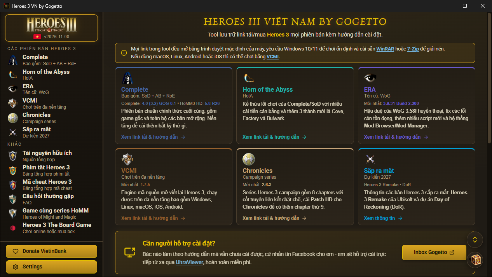
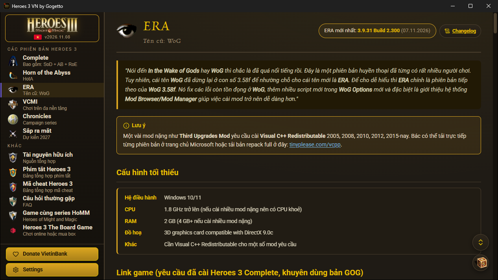
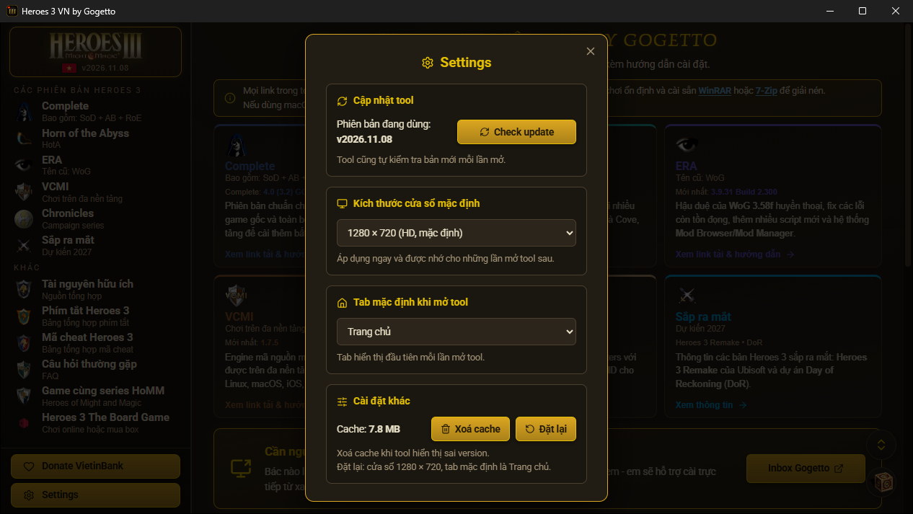
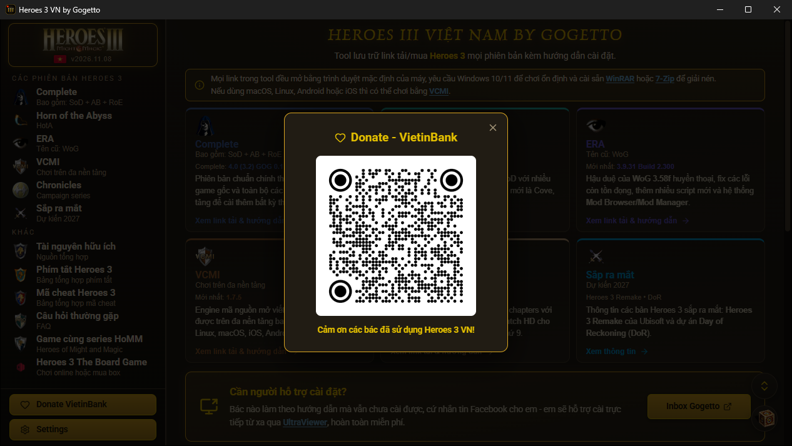

# _**⚔️ Heroes 3 VN by Gogetto ⚔️**_

[](https://quducute.github.io/Heroes3VN/) [](https://en.wikipedia.org/wiki/Microsoft_Windows) [](<https://en.wikipedia.org/wiki/Android_(operating_system)>) [](https://en.wikipedia.org/wiki/Vietnam)

<p align="center">
  
  
  
  
  <br /><em>Tool lưu trữ link tải/mua <strong>Heroes of Might and Magic III</strong> mọi phiên bản kèm hướng dẫn cài đặt bằng tiếng Việt.</em>
</p>

---

## 📖 Giới thiệu

**Heroes 3** là một tựa game chiến thuật huyền thoại, nhưng đối với người mới hoặc người chơi cũ mới trở lại, việc tìm đúng chỗ tải game vô cùng rắc rối: **Complete/SoD, HotA, ERA/WoG, VCMI, Chronicles...**, mỗi bản một nguồn tải, một cách cài đặt khác nhau; và để giải quyết vấn đề đó, **Heroes 3 VN** đã ra đời. Mọi thứ đã được gom hết lại ở một chỗ; chỉ cần mở tool lên và bấm chọn bản muốn chơi là ra đúng link tải/mua chính thức.

> [!NOTE]
> Tool này chỉ lưu trữ link từ các nguồn chính thức (GOG, Steam, trang chủ của mod...), không phát tán file game lậu.

---

## 📥 Tải về

[](https://github.com/quducute/Heroes3VN/releases/latest)

> [!TIP]
>
> - Bấm nút **[[MỚI NHẤT](https://github.com/quducute/Heroes3VN/releases/latest)]** phía trên hoặc bấm **[[Releases](https://github.com/quducute/Heroes3VN/releases)]** để vào trang download, sau đó tải file _**`Heroes3VN`**_ mới nhất tương ứng với hệ điều hành đang sử dụng (hiện tại tool đã có mặt trên Windows và Android).
> - Windows có hai lựa chọn, đều là file `.exe` portable chạy luôn không cần cài:
>   - **Bản Windows WebView2** (khuyên dùng): dung lượng nhẹ và chạy nhanh hơn rất nhiều, chỉ hỗ trợ Windows 10/11 có sẵn WebView2
>   - **Bản Windows**: dung lượng lớn hơn nhưng chạy ổn định trên mọi máy, kể cả những máy không có WebView2.
> - Với Android thì tải file `.apk` và cài trực tiếp vào máy
> - Nếu tool chưa hỗ trợ hệ điều hành bác đang sử dụng, hoặc đơn giản chỉ là bác lười tải? Dùng ngay **Heroes 3 VN bản Web** tại: _**<https://quducute.github.io/Heroes3VN/>**_

---

## ✨ Tính năng

- Giao diện tool phù hợp với Heroes 3, nhìn là thấy hoài niệm
- Đầy đủ 5 bản Heroes 3 phổ biến nhất kèm hướng dẫn cài đặt chi tiết:
  - **Complete - SoD + AB + RoE**
  - **Horn of the Abyss - HotA**
  - **ERA - tên cũ là In the Wake of Gods (WoG)**
  - **VCMI - engine mã nguồn mở đa nền tảng (Windows, Linux, macOS, iOS, Android)**
  - **Chronicles - series campaign Heroes 3**
- Link mua chính thức trên cả **GOG** (khuyên dùng) và **Steam**
- Hướng dẫn cài **HD Patch** và **Random Map Templates** cho Complete, HotA, ERA kèm ảnh minh hoạ (bấm vào ảnh để phóng to)
- Có mục FAQ giải đáp những thắc mắc của đa số người dùng
- Tài nguyên Heroes 3 phong phú: HoMM3 HD Patch, SoD SP Plugin, template hot (8XM8, 8XM8a, Duel, Jebus Outcast) cùng nhiều tài nguyên hữu ích khác
- Bảng tổ hợp phím tắt và bảng mã cheat Heroes 3 mọi phiên bản đầy đủ, tiện lợi cho việc tra cứu và sử dụng
- Theo dõi version mới nhất của các bản Heroes 3, tool hiển thị ngay khi có phiên bản mới kèm ngày phát hành
- Mọi link mở bằng trình duyệt mặc định của máy (hoặc copy link để mở bằng trình duyệt tuỳ chọn), đề cao sự an toàn và minh bạch
- Settings: chọn tab mặc định khi mở tool, kiểm tra cập nhật tool, xoá cache và đặt lại cài đặt; riêng bản Windows có thêm chọn kích thước cửa sổ mặc định

---

## 🌐 Cộng đồng & Ủng hộ

- **YouTube Channel: _<https://www.youtube.com/@Heroes3VN>_**
- **Server Discord: _<https://discord.gg/XM2EWmYF3u>_**
- **Donate:** quét mã QR **VietinBank** dưới đây hoặc ở trong tool (nút Donate tại góc trái bên dưới sidebar)

<details align="center">
  <summary>Bấm để hiện mã QR!</summary>
  <p></p>
</details>

---

## 💻 Mã nguồn

> [!IMPORTANT]
>
> - Mã nguồn được phát hành dưới **giấy phép [MIT](LICENSE)**
> - Prerequisites: **JavaScript**, **HTML/CSS** và **Rust**

| Thư mục                 | Nền tảng           | Công nghệ / Công dụng                                     |
| ----------------------- | ------------------ | --------------------------------------------------------- |
| **`shared/`**           | Dùng chung         | Nội dung, hình ảnh và giao diện PC dùng chung cho các bản |
| **`web/`**              | Web (GitHub Pages) | React + Vite + Tailwind CSS + GitHub Actions              |
| **`desktop/`**          | Windows            | React + Vite + Tailwind CSS + Electron                    |
| **`desktop-webview2/`** | Windows (WebView2) | React + Vite + Tailwind CSS + Tauri v2                    |
| **`mobile/`**           | Android, iOS       | React Native + Expo + Tailwind CSS (Uniwind)              |
| **`release/`**          | Desktop, Mobile    | Chứa các file thành phẩm sau khi build                    |

### Kiến trúc hệ thống

<details align="center">
  <summary>Bấm để hiện sơ đồ!</summary>
  <p></p>
</details>

### Tải mã nguồn về máy

```bash
# B0. Cài Git (bỏ qua nếu máy đã có)
winget install -e --id Git.Git

# B1. Clone repo về máy
git clone https://github.com/quducute/Heroes3VN.git

# B2. Cài Node.js LTS
winget install -e --id OpenJS.NodeJS.LTS
```

### Bản Web

```bash
# B1. Vào thư mục bản Web
cd Heroes3VN/web

# B2. Cài dependencies
npm install
```

| Lệnh               | Công dụng                                           |
| ------------------ | --------------------------------------------------- |
| `npx eslint .`     | Dùng ESLint để rà soát code                         |
| `npm run build`    | Build web ra `dist/` kèm trang tĩnh cho từng route  |
| `npx vite preview` | Mở bản build trong `dist/` để test trước khi deploy |

### Bản Windows

```bash
# B1. Vào thư mục bản Windows
cd Heroes3VN/desktop

# B2. Cài dependencies
npm install
```

| Lệnh              | Công dụng                                             |
| ----------------- | ----------------------------------------------------- |
| `npx eslint .`    | Dùng ESLint để rà soát code                           |
| `npm run preview` | Build rồi mở app test (đầy đủ chức năng)              |
| `npm run build`   | Build rồi đóng gói file `.exe` portable ra `release/` |

### Bản Windows WebView2

```bash
# B1. Cài Visual Studio Build Tools
winget install -e --id Microsoft.VisualStudio.2022.BuildTools

# B2. Cài Rust
winget install -e --id Rustlang.Rustup

# B3. Vào thư mục bản Windows WebView2
cd Heroes3VN/desktop-webview2

# B4. Cài dependencies
npm install
```

| Lệnh            | Công dụng                                             |
| --------------- | ----------------------------------------------------- |
| `npx eslint .`  | Dùng ESLint để rà soát code                           |
| `npx tauri dev` | Mở app test live (đầy đủ chức năng)                   |
| `npm run build` | Build rồi đóng gói file `.exe` portable ra `release/` |

### Bản Mobile

```bash
# B1. Cài EAS CLI (để build file cài)
npm install -g eas-cli

# B2. Đăng nhập tài khoản Expo
eas login

# B3. Vào thư mục bản Mobile
cd Heroes3VN/mobile

# B4. Cài dependencies
npm install

# B5. Gắn EAS_PROJECT_ID vào file .env tạo từ mẫu (thay ... bằng ID của project trên expo.dev)
cp .env.example .env
echo "EAS_PROJECT_ID=..." > .env
```

| Lệnh                                 | Công dụng                                                                 |
| ------------------------------------ | ------------------------------------------------------------------------- |
| `npx eslint .`                       | Dùng ESLint để rà soát code                                               |
| `npx expo start`                     | Chạy dev server để test app qua Expo Go                                   |
| `eas build -p android -e preview`    | Đóng gói file `.apk` để cài trực tiếp vào máy                             |
| `eas build -p android -e production` | Đóng gói file `.aab` để đưa lên Google Play Store                         |
| `eas build -p ios -e production`     | Đóng gói file `.ipa` để đưa lên App Store (cần tài khoản Apple Developer) |

---

## ©️ Credits

- **Ubisoft Entertainment S.A.** là đơn vị duy nhất nắm giữ bản quyền hợp pháp của trò chơi **Heroes of Might and Magic III**
- Cảm ơn **HotA Crew**, **ERA Team**, **VCMI Team** cùng các modder khác đã làm nên những phiên bản **Heroes 3** tuyệt vời mà tool đang giới thiệu
- **Heroes 3 VN** chỉ là một dự án phi lợi nhuận làm tặng cộng đồng, **không liên quan đến bất kỳ tổ chức hay đơn vị nào khác**

---

_**❤️ From [Gogetto](https://www.facebook.com/qudu.Gogetto) with love!**_
