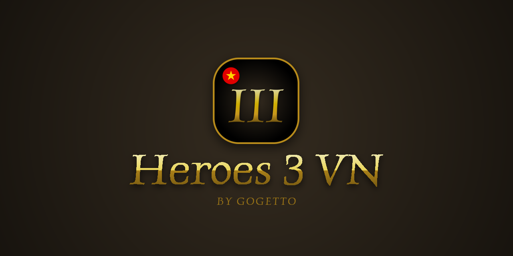
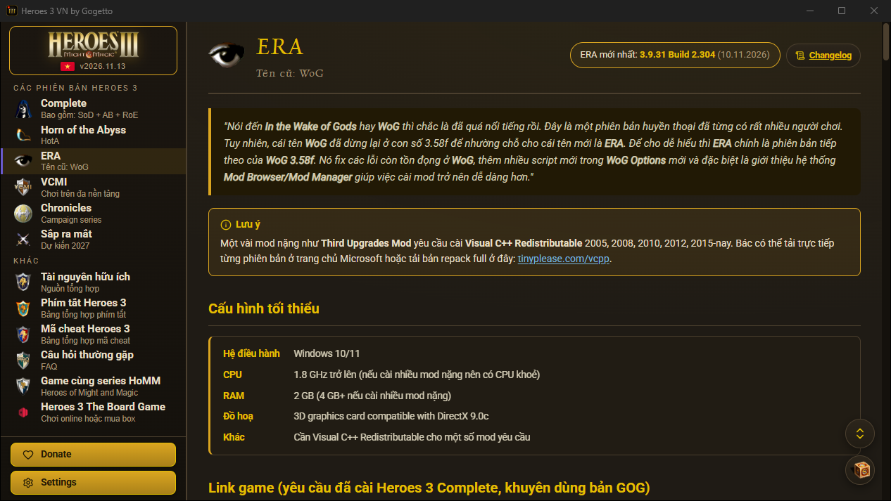
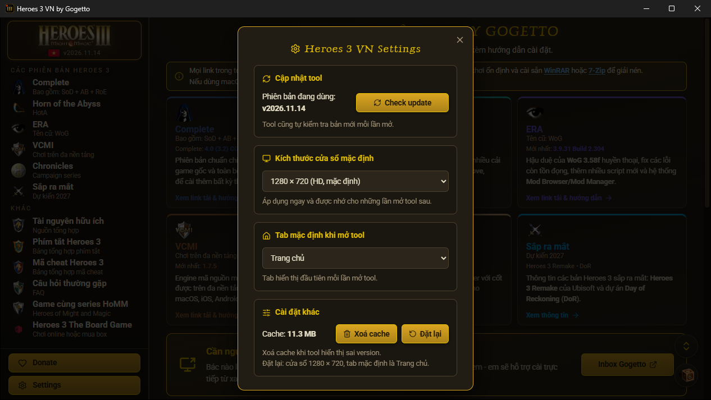
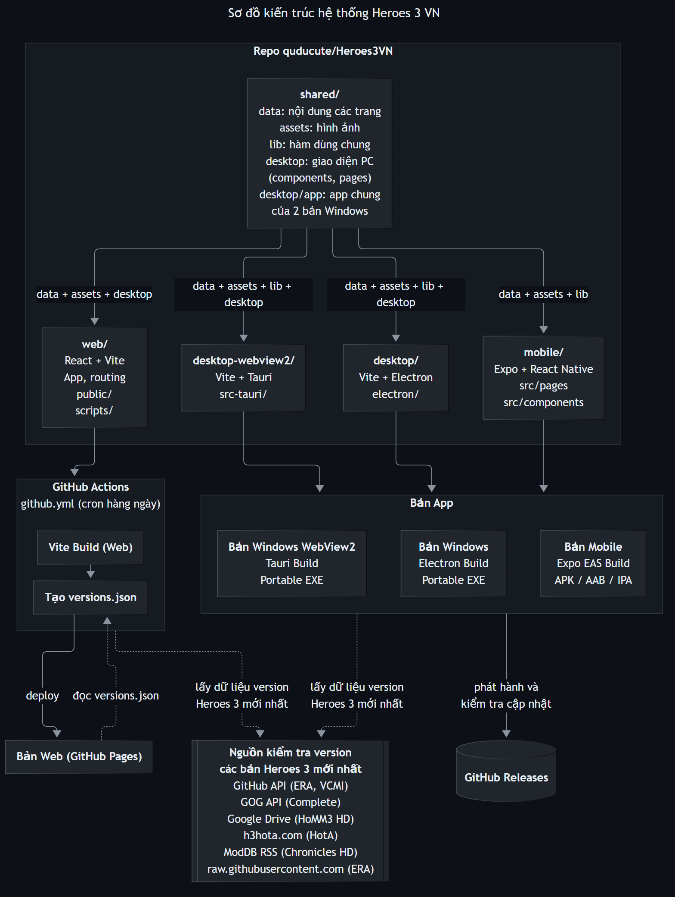

# _**⚔️ Heroes 3 VN by Gogetto ⚔️**_

<p align="center">
  
  <br><a href="https://github.com/quducute/Heroes3VN"></a> <a href="https://github.com/quducute/Heroes3VN"></a> <a href="https://github.com/quducute/Heroes3VN"></a> <a href="https://github.com/quducute/Heroes3VN"></a> <a href="https://github.com/quducute/Heroes3VN"></a> <a href="https://github.com/quducute/Heroes3VN"></a>
  <br><em>Tool lưu trữ link tải/mua <strong>Heroes of Might and Magic III</strong> mọi phiên bản kèm hướng dẫn cài đặt bằng tiếng Việt.</em>
</p>

---

## 📖 Giới thiệu

**Heroes 3** là một tựa game chiến thuật huyền thoại, nhưng đối với người mới hoặc người chơi cũ mới trở lại, việc tìm đúng chỗ tải game vô cùng rắc rối: **Complete/SoD, HotA, ERA/WoG, VCMI, Chronicles...**, mỗi bản một nguồn tải, một cách cài đặt khác nhau; và để giải quyết vấn đề đó, **Heroes 3 VN** đã ra đời. Mọi thứ đã được gom hết lại ở một chỗ; chỉ cần mở tool lên và bấm chọn bản muốn chơi là ra đúng link tải/mua chính thức.

> [!NOTE]
> Tool chỉ lưu trữ link từ các nguồn chính thức (GOG, Steam, trang chủ của mod...), không phát tán file game lậu.

---

## 📥 Tải về

[](https://github.com/quducute/Heroes3VN/releases/latest)

> [!TIP]
>
> - Bấm nút **[[MỚI NHẤT](https://github.com/quducute/Heroes3VN/releases/latest)]** phía trên hoặc bấm **[[Releases](https://github.com/quducute/Heroes3VN/releases)]** để vào trang download, sau đó tải file _**`Heroes3VN`**_ mới nhất tương ứng với hệ điều hành đang sử dụng (hiện tại tool đã có mặt trên Windows và Android)
> - Windows có hai lựa chọn, đều là file `.exe` portable chạy luôn không cần cài:
>   - **Bản Windows WebView2** (khuyên dùng): dung lượng nhẹ và chạy nhanh hơn rất nhiều, chỉ hỗ trợ Windows 10/11 có sẵn WebView2
>   - **Bản Windows**: dung lượng lớn hơn nhưng chạy ổn định trên mọi máy, kể cả những máy không có WebView2
> - Với Android thì tải file `.apk` và cài trực tiếp vào máy
> - Nếu tool chưa hỗ trợ hệ điều hành bác đang dùng, hoặc đơn giản là bác lười tải app? Dùng ngay **Heroes 3 VN bản Web** tại: _**<https://quducute.github.io/Heroes3VN/>**_

---

## 🖼️ Hình ảnh

Giao diện mang tông màu nâu vàng cùng phong cách đặc trưng của Heroes 3, tạo cảm giác quen thuộc khi sử dụng. Các mục trên sidebar cũng được sắp xếp gọn gàng theo từng nhóm; cần tìm mục nào, chỉ cần bấm chọn là có ngay.

|          Tab Trang Chủ          |          Tab Hướng Dẫn          |          Tab Settings           |
| :-----------------------------: | :-----------------------------: | :-----------------------------: |
|  |  |  |

---

## ✨ Tính năng

[](https://en.wikipedia.org/wiki/Vietnam)

- Đầy đủ 5 bản Heroes 3 phổ biến nhất hiện nay:
  - **Complete - SoD + AB + RoE**
  - **Horn of the Abyss - HotA**
  - **ERA - tên cũ là In the Wake of Gods (WoG)**
  - **VCMI - engine mã nguồn mở đa nền tảng (Windows, Linux, macOS, iOS, Android)**
  - **Chronicles - series campaign Heroes 3**
- Hướng dẫn cài đặt chi tiết từng bản, cùng với HD Patch, Random Map Templates,... kèm ảnh minh hoạ (bấm vào từng ảnh để phóng to) và mục tổng hợp FAQ giải đáp những thắc mắc của đa số người dùng
- Tài nguyên Heroes 3 phong phú: HoMM3 HD Patch, SoD SP Plugin, Template hot (8XM8, 8XM8a, Duel, Jebus Outcast) cùng nhiều tài nguyên hữu ích khác
- Bảng tổ hợp phím tắt và bảng mã cheat Heroes 3 mọi phiên bản đầy đủ, có chức năng tìm kiếm tiện lợi cho việc tra cứu và sử dụng
- Theo dõi version mới nhất của các bản Heroes 3, tool hiển thị ngay khi có phiên bản mới kèm ngày phát hành
- Mọi link mở bằng trình duyệt mặc định của máy (hoặc copy link để mở bằng trình duyệt tuỳ chọn), đề cao sự an toàn và minh bạch
- Settings: chọn tab mặc định khi mở tool, kiểm tra cập nhật tool (luôn tự động kiểm tra khi mở tool), xoá cache và đặt lại cài đặt, tuỳ chỉnh kích thước cửa sổ mặc định của tool (chỉ dành cho bản Windows)
- Bản Web cài được như app (luôn tự động cập nhật khi có mạng) và mở được khi không có mạng (nhờ service worker lưu sẵn toàn bộ trang)

---

## 🌐 Cộng đồng & Ủng hộ

- **Kênh YouTube: _<https://www.youtube.com/@Heroes3VN>_**
- **Server Discord: _<https://discord.gg/XM2EWmYF3u>_**
- **Donate:** quét mã QR **VietinBank** dưới đây hoặc ở trong tool (nút Donate ở góc dưới bên trái sidebar)

<details align="center">
  <summary>Bấm để hiện mã QR!</summary>
  <p></p>
</details>

---

## 💻 Mã nguồn

[](LICENSE)

> [!IMPORTANT]
>
> - Prerequisites: **JavaScript**, **HTML/CSS** và **Rust**
> - Mọi ý kiến đóng góp cho **Heroes 3 VN** đều được hoan nghênh tại **[Issues](https://github.com/quducute/Heroes3VN/issues)** và **[Pull requests](https://github.com/quducute/Heroes3VN/pulls)**

| Thư mục                  | Nền tảng           | Công nghệ / Công dụng                              |
| ------------------------ | ------------------ | -------------------------------------------------- |
| **`.github/workflows/`** | GitHub Actions     | Deploy bản Web lên GitHub Pages và nhiều việc khác |
| **`web/`**               | Web (GitHub Pages) | ReactJS + Vite + Tailwind CSS + PWA                |
| **`desktop-webview2/`**  | Windows (WebView2) | ReactJS + Vite + Tailwind CSS + Tauri              |
| **`desktop/`**           | Windows            | ReactJS + Vite + Tailwind CSS + Electron           |
| **`mobile/`**            | Android, iOS       | React Native + Expo + Tailwind CSS (Uniwind)       |
| **`shared/`**            | Dùng chung         | Nội dung, ảnh, giao diện và code dùng chung        |
| **`release/`**           | Dùng chung         | Chứa các file thành phẩm sau khi build             |



### Tải mã nguồn về máy

```bash
# B0. Cài Git (bỏ qua nếu máy đã có)
winget install -e --id Git.Git

# B1. Clone repo về máy
git clone https://github.com/quducute/Heroes3VN.git

# B2. Cài Node.js LTS
winget install -e --id OpenJS.NodeJS.LTS
```

### Bản Web

```bash
# B1. Vào thư mục bản Web
cd Heroes3VN/web

# B2. Cài dependencies
npm install
```

| Lệnh               | Công dụng                                           |
| ------------------ | --------------------------------------------------- |
| `npm run build`    | Build web ra `dist/` kèm trang tĩnh cho từng route  |
| `npx vite preview` | Mở bản build trong `dist/` để test trước khi deploy |

### Bản Windows WebView2

```bash
# B1. Cài Visual Studio Build Tools
winget install -e --id Microsoft.VisualStudio.2022.BuildTools

# B2. Cài Rust
winget install -e --id Rustlang.Rustup

# B3. Vào thư mục bản Windows WebView2
cd Heroes3VN/desktop-webview2

# B4. Cài dependencies
npm install
```

| Lệnh            | Công dụng                                             |
| --------------- | ----------------------------------------------------- |
| `npx tauri dev` | Mở app test live (đầy đủ chức năng)                   |
| `npm run build` | Build rồi đóng gói file `.exe` portable ra `release/` |

### Bản Windows

```bash
# B1. Vào thư mục bản Windows
cd Heroes3VN/desktop

# B2. Cài dependencies
npm install
```

| Lệnh              | Công dụng                                             |
| ----------------- | ----------------------------------------------------- |
| `npm run preview` | Build rồi mở app test (đầy đủ chức năng)              |
| `npm run build`   | Build rồi đóng gói file `.exe` portable ra `release/` |

### Bản Mobile

```bash
# B1. Cài EAS CLI (để build file cài)
npm install -g eas-cli

# B2. Đăng nhập tài khoản Expo
eas login

# B3. Vào thư mục bản Mobile
cd Heroes3VN/mobile

# B4. Cài dependencies
npm install

# B5. Tạo file .env chứa EAS_PROJECT_ID (thay ... bằng ID của project trên expo.dev)
echo "EAS_PROJECT_ID=..." > .env
```

| Lệnh                                 | Công dụng                                                                 |
| ------------------------------------ | ------------------------------------------------------------------------- |
| `npx expo start`                     | Chạy dev server để test app qua Expo Go                                   |
| `eas build -p android -e preview`    | Đóng gói file `.apk` để cài trực tiếp vào máy                             |
| `eas build -p android -e production` | Đóng gói file `.aab` để đưa lên Google Play Store                         |
| `eas build -p ios -e production`     | Đóng gói file `.ipa` để đưa lên App Store (cần tài khoản Apple Developer) |

---

## ©️ Credits

- **Ubisoft Entertainment S.A.** là đơn vị duy nhất nắm giữ bản quyền hợp pháp của trò chơi **Heroes of Might and Magic III**
- Cảm ơn **HotA Crew**, **ERA Team**, **VCMI Team** cùng các modder khác đã làm nên những phiên bản **Heroes 3** tuyệt vời mà tool đang giới thiệu
- **Heroes 3 VN** chỉ là một dự án phi lợi nhuận làm tặng cộng đồng, **không liên quan đến bất kỳ tổ chức hay đơn vị nào khác**

---

_**❤️ From [Gogetto](https://www.facebook.com/qudu.Gogetto) with love!**_
